# Campus Club Finder: Documentation

This document walks through the app from its initial state, page by page, and shows every feature in action. All screenshots are in `docs/screenshots/`.

## Contents

1. [Initial state](#1-initial-state)
2. [Home page](#2-home-page)
3. [Club list page](#3-club-list-page)
4. [Club detail page and joining a club](#4-club-detail-page-and-joining-a-club)
5. [About page](#5-about-page)
6. [404 Not Found page](#6-404-not-found-page)
7. [Navigation](#7-navigation)
8. [Responsive design](#8-responsive-design)
9. [Accessibility](#9-accessibility)
10. [How it works under the hood](#10-how-it-works-under-the-hood)

---

## 1. Initial state

When a student opens the app for the first time:

- The app opens on the Home page (`/`).
- `localStorage` has no joined clubs, so every club is shown as not joined.
- The five default clubs come from `src/data/clubs.js`: Robotics Club, Photography Club, Debate Society, Music Ensemble, and Hiking & Outdoors Club.
- On the club list, clubs are sorted by name A to Z and shown in grid view.

To run the app yourself, follow the steps in [README.md](./README.md#getting-started).

---

## 2. Home page

**Route:** `/`

The Home page introduces the app. It has:

- A welcome headline and a short description of what the app does
- A hero illustration of students gathering at a campus building
- A **Browse Clubs** button that goes to `/clubs`
- A short "How it works" section: Browse, Learn, Join

**Desktop**

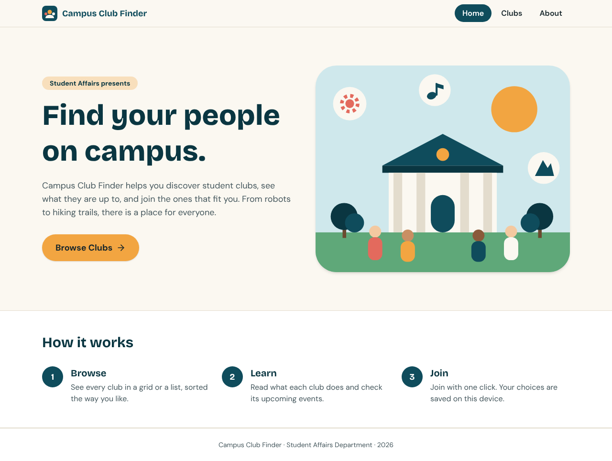

**Mobile**

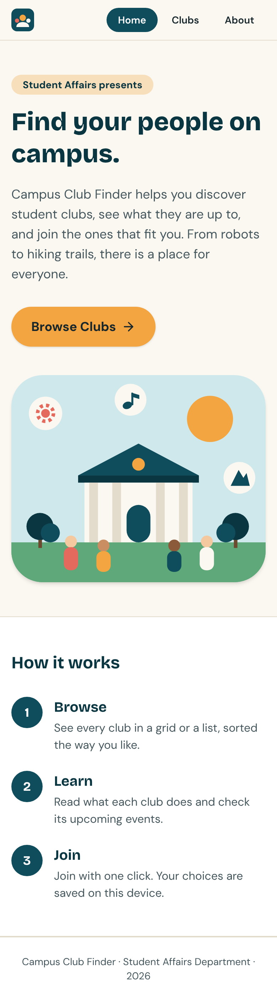

The **Navbar** at the top is shown on every page. It has the links Home, Clubs, and About, and the link for the current page is highlighted. Here, **Home** is highlighted.

---

## 3. Club list page

**Route:** `/clubs`

Clicking **Browse Clubs** or **Clubs** in the navbar opens the club list. All five clubs are shown as cards. Each card has the club image, the club name, a short description, and a **View Details** button.

### 3.1 Grid view (default)

On desktop, cards are shown in a three-column grid, sorted by name A to Z.

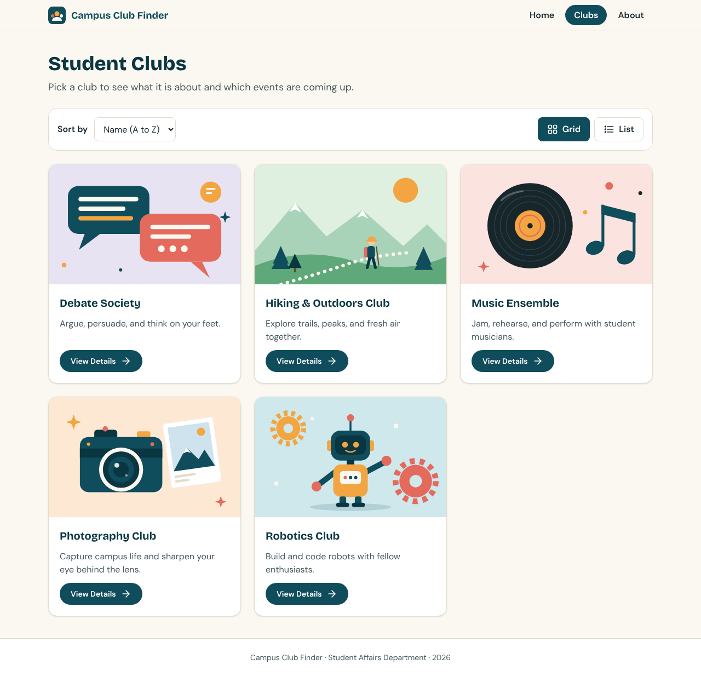

### 3.2 Sorting

Use the **Sort by** dropdown above the cards:

- **Name (A to Z)**: Debate Society, Hiking & Outdoors Club, Music Ensemble, Photography Club, Robotics Club
- **Name (Z to A)**: the same list in reverse

Choosing **Name (Z to A)** reorders the cards right away:

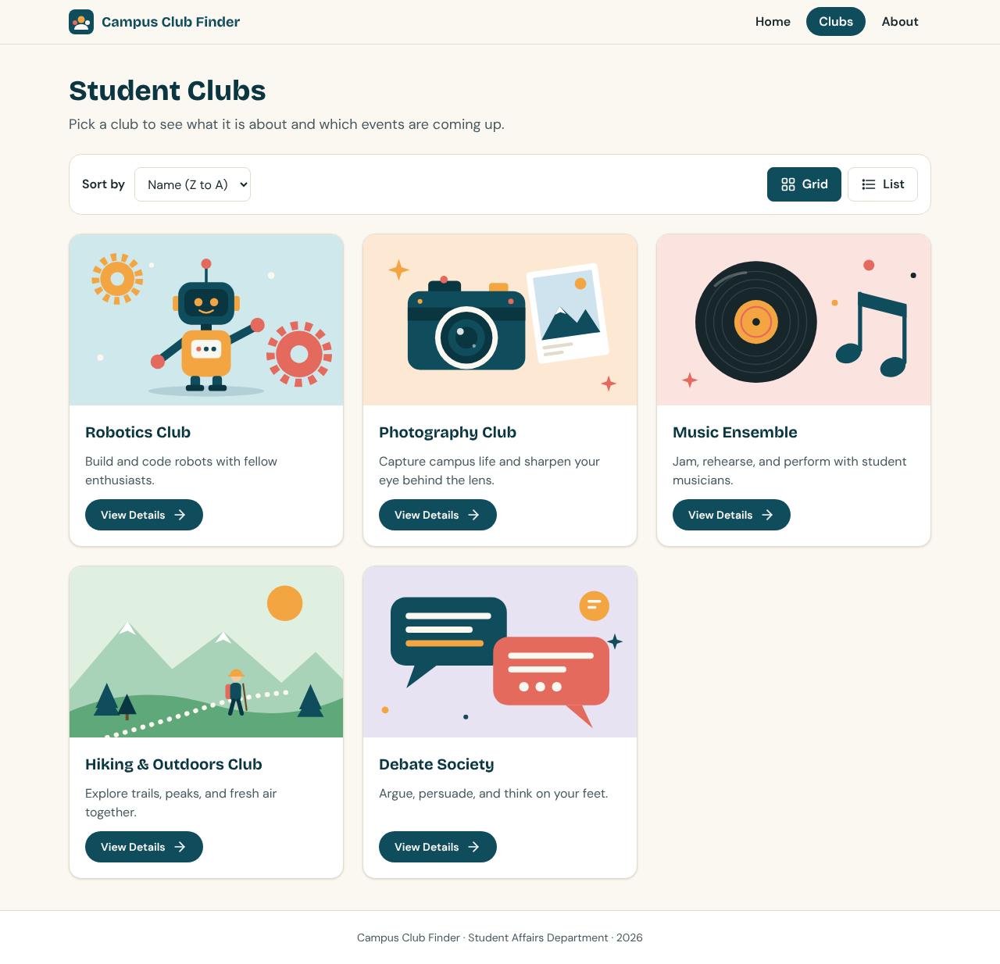

### 3.3 List view

Use the **Grid** and **List** buttons to change the layout. The active button is filled in. In list view, the cards are stacked vertically, with the image on the left and the text on the right. The current sort order is kept when you switch views.

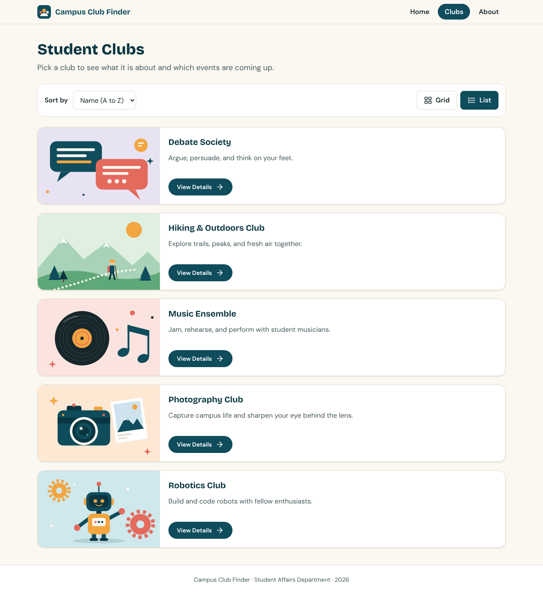

### 3.4 Opening a club

Click anywhere on a card, or its **View Details** button, to open that club's detail page.

---

## 4. Club detail page and joining a club

**Route:** `/clubs/:clubId` (for example, `/clubs/robotics`)

The detail page shows:

- The club name and a one-line summary
- A large image
- The full description under **About this club**
- At least two **Upcoming events**, each with its date
- A **Join Club** panel

### 4.1 Before joining

The **Join Club** button is active, and nothing is saved yet.

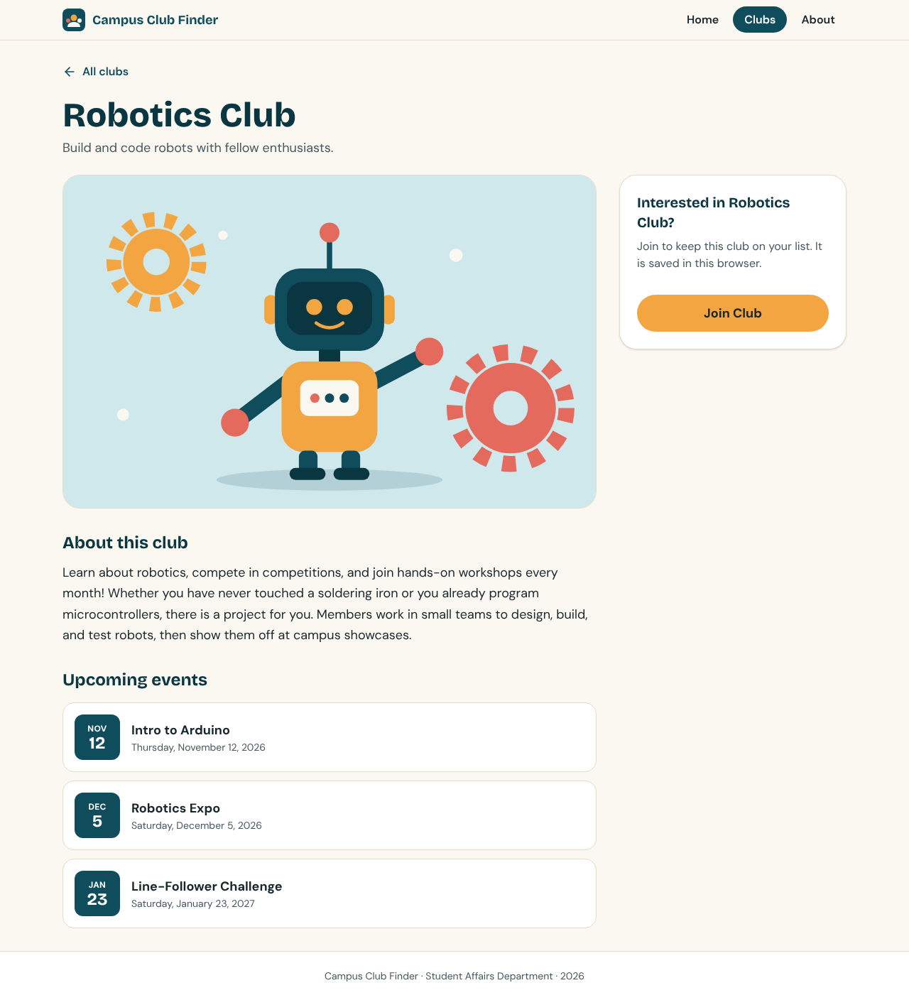

### 4.2 After joining

When the student clicks **Join Club**:

1. The club id is saved in `localStorage`.
2. A green confirmation appears: **You have joined this club!**, with a short welcome message.
3. The button changes to **Joined** and is disabled, so the club cannot be joined twice.

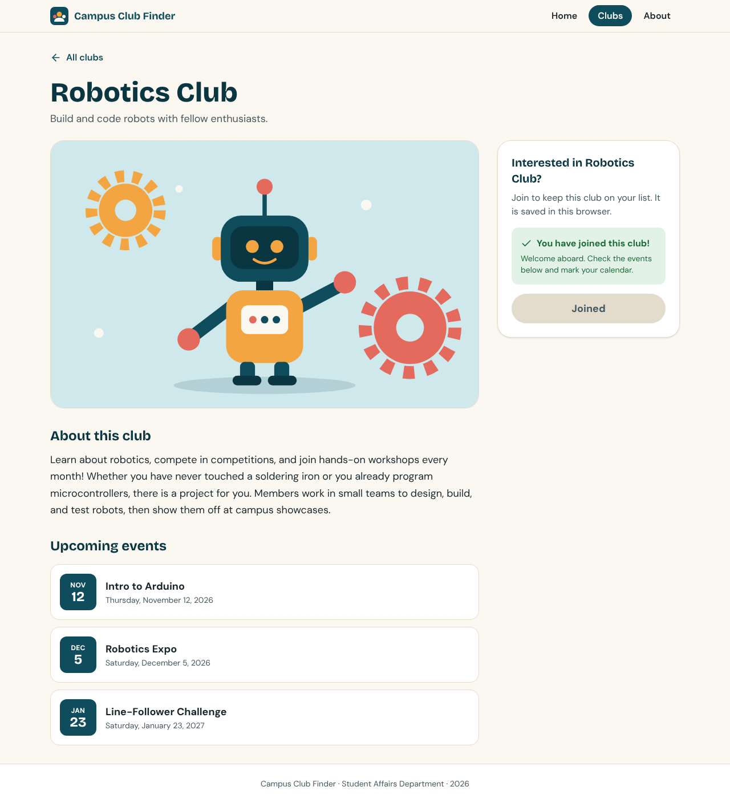

### 4.3 The choice is remembered

Because the choice is saved in `localStorage`, it stays after a page refresh or after closing the browser. When the student returns to the detail page, the message **You have joined this club!** is shown right away and the button is disabled. Joining one club does not affect any other club.

On the club list, joined clubs show a green **Joined** badge on their image:

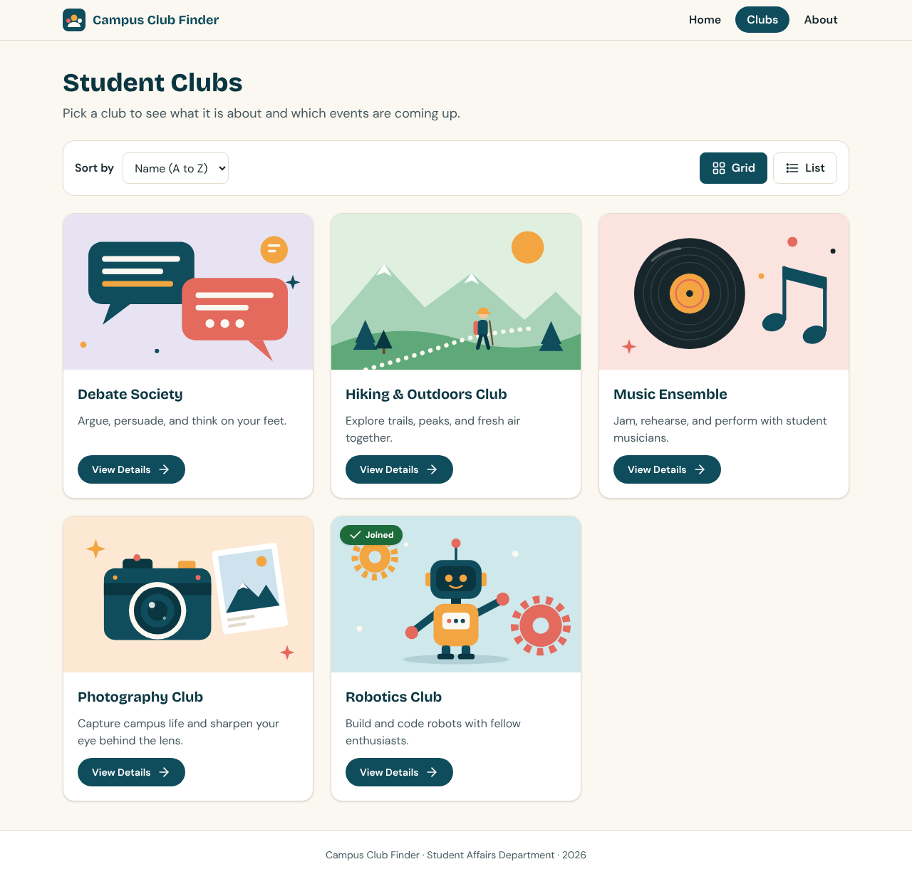

To see the saved data yourself, open the browser developer tools, go to **Application** (or **Storage**), then **Local Storage**, and look for the key `campus-club-finder:joined-clubs`. Its value is a list of joined club ids, such as `["robotics"]`.

### 4.4 Unknown club

If the address points to a club that does not exist (for example, `/clubs/unknown-club`), a friendly message is shown, with a button to see all clubs and a button back to Home.

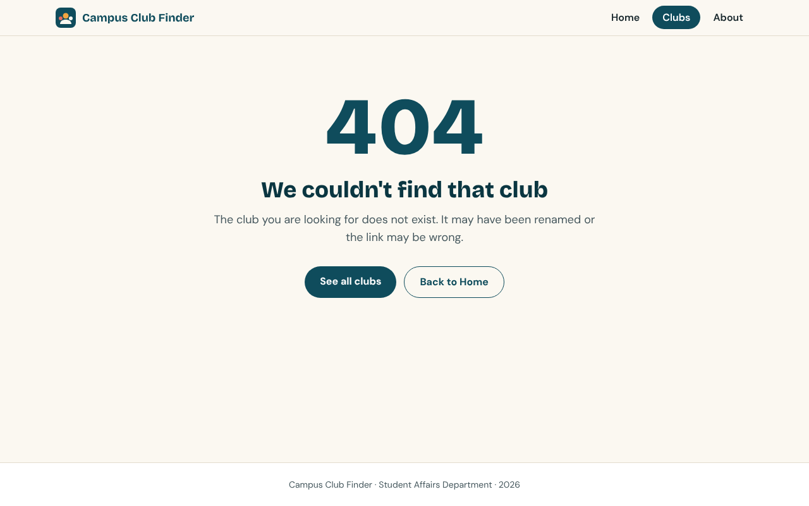

---

## 5. About page

**Route:** `/about`

The About page explains what the app does and lists the tech stack: Vite, React, React Router, Tailwind CSS, and `localStorage`. It also notes that there is no sign-in and no server, so joined clubs are stored only on the student's device.

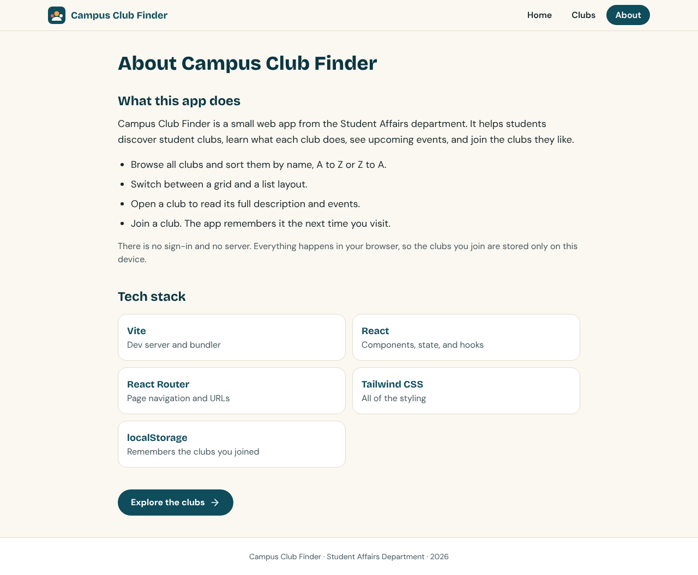

---

## 6. 404 Not Found page

**Route:** `*` (any address that does not match another route, for example `/this-page-does-not-exist`)

A friendly message is shown, together with the navbar and a **Back to Home** button.

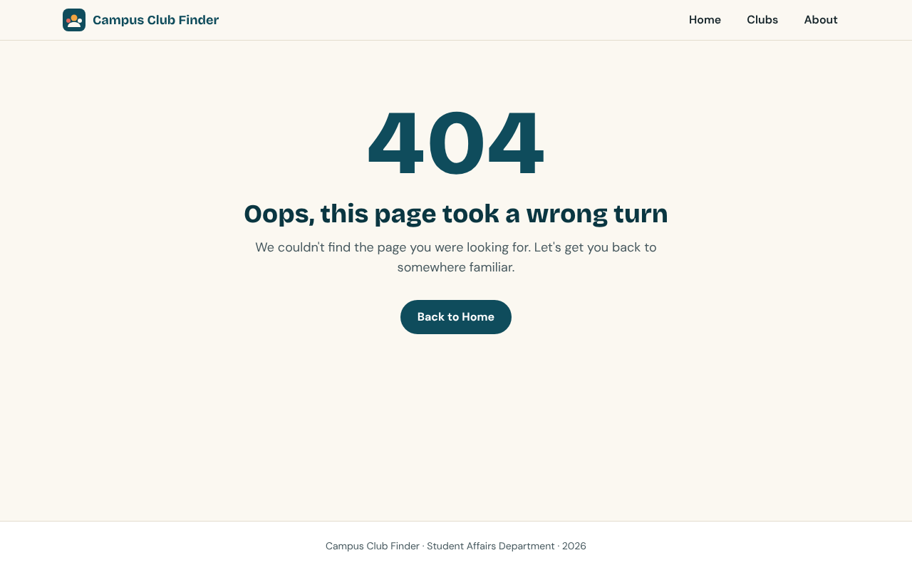

---

## 7. Navigation

| From | Action | To |
| --- | --- | --- |
| Any page | Navbar: Home, Clubs, About | `/`, `/clubs`, `/about` |
| Home | Browse Clubs | `/clubs` |
| Club list | Card or View Details | `/clubs/:clubId` |
| Club detail | All clubs | `/clubs` |
| 404 | Back to Home | `/` |

The navbar highlights the current page. The **Clubs** link stays highlighted on club detail pages too, since they belong to the Clubs section. Every page also scrolls back to the top and updates the browser tab title when you navigate.

---

## 8. Responsive design

The layout adapts to the screen size using Tailwind CSS only.

| Screen | Club list (grid view) | Club detail |
| --- | --- | --- |
| Mobile (under 640px) | 1 column | Single column; the Join panel comes before the events |
| Tablet (640px and up) | 2 columns | Single column |
| Desktop (1024px and up) | 3 columns | Two columns; the Join panel sits beside the content and stays in view |

**Mobile, grid view**

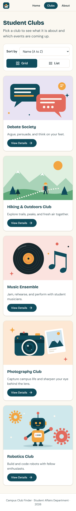

**Mobile, list view**

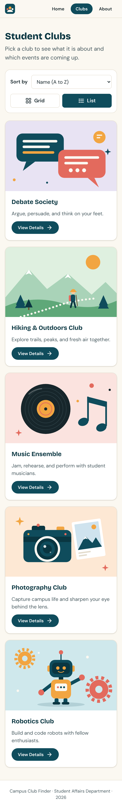

**Tablet**

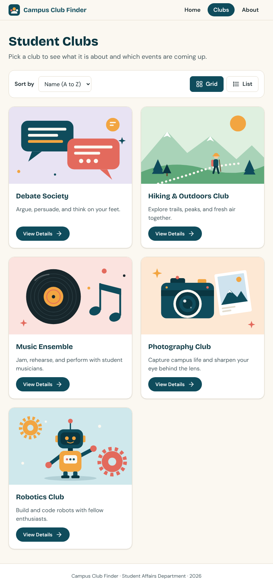

**Club detail on mobile**

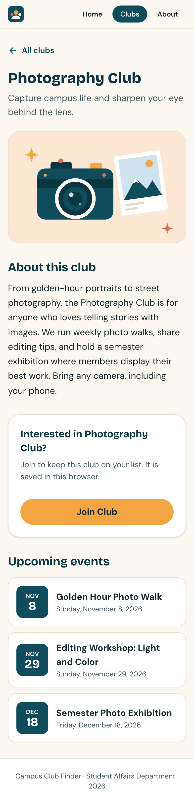

The pages were checked at widths of 360, 390, 768, and 1440 pixels, and none of them scroll sideways.

---

## 9. Accessibility

- Semantic structure: one `h1` per page, landmarks (`header`, `nav`, `main`, `footer`), and lists for cards and events
- A **Skip to main content** link appears when you press Tab on any page
- Every control is reachable by keyboard and has a clearly visible focus outline
- The current page in the navbar is marked with `aria-current="page"`
- The Grid and List buttons use `aria-pressed` to tell screen readers which one is active
- The sort dropdown has a visible label
- Images have descriptive `alt` text, and decorative icons are hidden from screen readers
- Changes such as "You have joined this club!" and the number of clubs shown are announced to screen readers
- Text colors meet WCAG AA contrast, and animations are turned off for people who prefer reduced motion

An automated check with axe-core (WCAG 2 A and AA rules) found no violations on any page, in light and dark mode, on desktop and mobile widths.

---

## 10. How it works under the hood

### Data

The five clubs are defined in `src/data/clubs.js`, separate from the UI. Each club has an `id`, `name`, `image`, `shortDescription`, `description`, and a list of `events` (each with a `name` and `date`).

### Sorting and view toggle

`ClubList` holds two pieces of state with `useState`:

```jsx
const [sort, setSort] = useState('name-asc')
const [view, setView] = useState('grid')
```

These values and their setters are passed down as props to `ClubControls` (the dropdown and the Grid/List buttons). `view` is also passed to each `ClubCard`, which changes its layout. The clubs are sorted from a copy of the data, so the original list is never changed.

### Joining a club

The `useJoinedClubs` hook keeps the list of joined club ids in React state, and saves it to `localStorage` under the key `campus-club-finder:joined-clubs` every time it changes. The list is read back when the app loads, which is why joining persists. The hook is used by the club list (for the badge) and by the detail page (for the button and message). If `localStorage` is empty, blocked, or contains invalid data, the app simply starts with no joined clubs.

### Routing

Routes are defined in `src/App.jsx` with React Router:

```jsx
<Routes>
  <Route path="/" element={<Home />} />
  <Route path="/clubs" element={<ClubList />} />
  <Route path="/clubs/:clubId" element={<ClubDetail />} />
  <Route path="/about" element={<About />} />
  <Route path="*" element={<NotFound />} />
</Routes>
```

`ClubDetail` reads the `clubId` from the address with `useParams` and looks up the matching club in the data file.

### Styling

All styling uses Tailwind CSS classes. The color palette and fonts are defined once in `src/index.css` using Tailwind's `@theme`, and the fonts are bundled with the app, so no external requests are needed.
